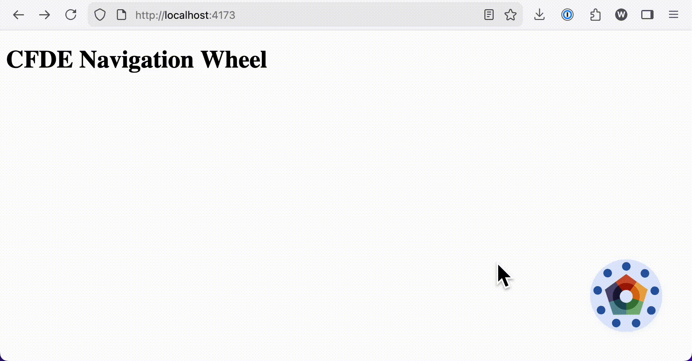

# CFDE Navigation Wheel Bundled Embed

This package builds a browser-ready bundle of [the CFDE Navigation Wheel component](https://github.com/MaayanLab/cfde-wheel) that can be embedded in any website via HTML.



## Use

### Basic Embed

Add this to your HTML page:

```html
<nav id="cfde-wheel"></nav>
<script src="path/to/cfde-wheel.iife.js"></script>
<!-- E.g. --><!--
<script src="https://cdn.jsdelivr.net/gh/TACC/cfde-wheel-embed@v0.1.4/dist/cfde-wheel.iife.js"></script>
-->
```

The script will auto-initialize the wheel into the element with ID `cfde-wheel`.

### Button Embed

Add `data-button` to the default container to place the wheel's launcher in the page layout. Clicking the button opens the navigation wheel.

```html
<nav id="cfde-wheel" data-button></nav>
<script src="path/to/cfde-wheel.iife.js"></script>
```

Use the updated bundle from `dist/cfde-wheel.iife.js` for button mode.

### Manual Initialize

If you want to initialize the wheel manually or use a different container:

```html
<nav id="my-custom-container"></nav>
<script src="path/to/cfde-wheel.iife.js"></script>
<script>
  // EITHER initialize in a custom container
  window.CFDEWheel.init('my-custom-container');

  // OR pass the element directly
  // const container = document.getElementById('my-custom-container');
  // window.CFDEWheel.init(container);
</script>
```

For a button in a custom container, pass `{ button: true }` as the second argument. The option works with either a container ID or an element.

```html
<nav id="my-custom-container"></nav>
<script src="path/to/cfde-wheel.iife.js"></script>
<script>
  window.CFDEWheel.init('my-custom-container', { button: true });
</script>
```

### Run the Button Demo

The [button demo](examples/button.html) mounts the wheel with `{ button: true }`.
Use **Move wheel to footer** to move the same launcher from the header to the footer.
For your own embed, place the mount element wherever you want the launcher and position it with your page's CSS.

From the repository root, run:

```bash
npm ci
npm start
```

Open [the button demo](http://localhost:4173/button.html). If Vite prints a different port, use that port with `/button.html`.

## Develop

### Install

```bash
npm ci
```

### Build & Preview

```bash
npm start
```

OR

```bash
npm run build
npm run preview
```
